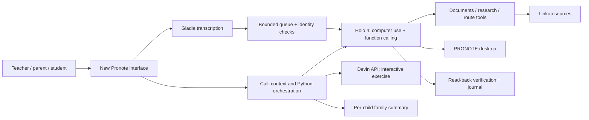

# Calli — an assistant that works alongside you

[](https://github.com/CalliH2026/app/actions/workflows/ci.yml)

**Observe context. Anticipate the next useful task. Act through tools and computer use.**

Calli turns an existing school workflow into a clearer interface, **New Pronote**. Opening a pupil’s work triggers a sourced preparation while the teacher keeps working. The assistant combines H Company **Holo 4**, function calling and real PRONOTE desktop control; Gladia, Linkup and Devin supply speech transcription, research and interactive practice.

Built for the **H Company × 42AI Computer Use Agents Hackathon**, 7–8 November 2026. Team: **François, Wilfred, Liqin**.

## Try it

- **[Open the demo](https://calli-demo.leisurelychestnut.chatgpt.site)** · **[Judge’s guide](https://calli-demo.leisurelychestnut.chatgpt.site/guide)**
- **[Watch the final demo video](https://www.youtube.com/watch?v=mILSh_vLQck)** — 1:59.8, English narration.
- **[Pitch deck (PDF)](docs/pitch/calli-pitch-en.pdf)** · [Editable PowerPoint](docs/pitch/calli-pitch-en.pptx) · [Speaker notes](docs/pitch/speaker-notes.md)

The public demo is interactive and uses saved outputs from recorded runs. It needs no login or API key. It does not execute new agents or write to PRONOTE. The full application and provider integrations are included below; the video shows the native desktop execution. Demo pupils and family records are fictional.

## What to explore

| Role | Working experience |
|---|---|
| Teacher | Open a pupil’s copy; Calli prepares a report with checked sources. Dictate an appreciation; the native writer enters it in PRONOTE and checks the read-back. |
| Student | Practice with an interactive Devin-generated exercise, hints and answer feedback. |
| Parent | Grégory Martin sees Alex and Lucas together: results, comments, sources and next actions. |
| Administration | Inspect school-trip research, routes, costs and required follow-up. Production attendance management remains a future use case. |

Observation currently covers registered document openings **inside Calli**. It is not general desktop surveillance. Background preparation overlaps the user’s work; the orchestration graphic illustrates tool relationships rather than asserting that every recorded call ran simultaneously.

## Run the keyless preview

Requires Node.js 20 or newer; no npm dependencies or provider credentials.

```bash
git clone https://github.com/CalliH2026/app.git
cd app/sites/calli-demo
npm run build
npm test
npm run serve
```

Open http://127.0.0.1:8787. [Preview deployment and route details](sites/calli-demo/README.md).

## Run the integrated application

Requires Python 3.10+; Python 3.12 is recommended. Run from the repository root.

```bash
python3 -m venv .venv
source .venv/bin/activate  # Windows: .venv\Scripts\activate
python -m pip install -e '.[shell,voice,dev]'
python -m ui.shell --stop
```

Open http://127.0.0.1:8000. `--stop` starts the local workspace in review mode. It does not launch the native writer. Optional provider credentials belong in your local environment or `mvp/.env`; see [.env.example](.env.example). Enable only the integrations you intend to run.

For real dictation and native entry, configure Gladia, H and a desktop running PRONOTE, then launch the writer separately. See [workspace and native setup](docs/parallel-workspace.md), [PRONOTE trial setup](docs/pronote-setup.md) and [API inventory](docs/calli-api-and-architecture.md). The historical standalone approval UI is retained as a fallback; the integrated workspace automatically queues an unambiguous completed dictation.

## How the pieces fit



| Partner / service | Integration and scope |
|---|---|
| **H Company / Holo 4** | Real desktop computer use, tool selection and function calling. Optional local Workstation runtime is configured separately; hosted and local execution are distinguished in run provenance. |
| **Gladia** | Live dictation and transcription of parent audio. |
| **Linkup** | Educational research, including concrete learning-science principles used in new exercise briefs. |
| **Cognition / Devin** | Product API generates interactive practice. Devin also supported development and the Windows PRONOTE VM environment. |
| **Stripe** | Optional hosted Checkout and signed-webhook ledger; implemented and tested offline, not yet verified with a configured merchant account. |
| **Google Calendar / OSRM** | Optional calendar integration and school-trip route estimates. A route or estimate does not book transport. |
| **ElevenLabs** | Synthetic demo narration and fictional parent voices. |

## Evidence and impact

Recorded native results include **10/10 matching comments in 300.8 seconds** on the PRONOTE trial, and a separate integrated single-item run of **25.57 seconds from queue to verified result**. These are agent timings, not a measured human comparison. Failures and earlier trials are retained below.

The final film’s **43% reduction in active entry time** is a scenario with intervention allowances. The France-wide **~3 million hours / ~€120 million annual gross time value** is a full-adoption model for secondary teachers, not observed savings or a budget reduction. [Annual assumptions](docs/annual-time-scenarios.md), [national calculation](docs/national-impact-scenario.md), [benchmark protocol](docs/benchmark-protocol.md).

<details>
<summary>Recorded run scoreboard — including unsuccessful trials</summary>

<!-- scoreboard:start -->
| Run | Arm | Model | Attempted | Verified | Abstained | Mismatch | False success | Aborted | Not found | s/item median | s/item worst | Steps | Tokens / verified | $ / verified (list price) |
|---|---|---|---:|---:|---:|---:|---:|---:|---:|---:|---:|---:|---:|---:|
| 20261107-125935 | calligraphe | holo4-27b | 1 | 0 | 0 | 1 | 0 | 0 | 0 | 138.1 | 138.1 | 43 | — | — |
| 20261107-130538 | calligraphe | holo4-27b | 3 | 1 | 0 | 1 | 0 | 0 | 1 | 51.5 | 417.0 | 103 | 4387408 | 0.6592 |
| 20261107-132407 | calligraphe | holo4-27b | 8 | 6 | 0 | 1 | 0 | 0 | 1 | 77.8 | 201.6 | 160 | 1106281 | 0.1492 |
| 20261107-133709 | calligraphe | holo4-27b | 2 | 1 | 0 | 0 | 0 | 0 | 1 | 76.1 | 77.7 | 62 | 1536519 | 0.2499 |
| 20261107-133807 | calligraphe | holo4-27b | 7 | 7 | 0 | 0 | 0 | 0 | 0 | 71.6 | 128.1 | 129 | 644889 | 0.0891 |
| 20261107-140107 | calligraphe | holo4-27b | 7 | 6 | 0 | 1 | 0 | 0 | 0 | 92.1 | 667.3 | 207 | 1668367 | 0.3420 |
| 20261107-140107-baseline | baseline | holo4-27b | 8 | 0 | 0 | 0 | 0 | 8 | 0 | 29.2 | 29.2 | 113 | — | — |
| 20261107-142016-baseline | baseline | holo4-27b | 8 | 8 | 0 | 0 | 0 | 0 | 0 | 35.6 | 35.6 | 56 | 189592 | 0.0391 |
| 20261107-143108-audit | audit | holo4-27b | 8 | 8 | 0 | 0 | 0 | 0 | 0 | 18.6 | 18.6 | 30 | 75429 | 0.0192 |
| 20261107-152520 | calligraphe | holo4-27b | 10 | 10 | 0 | 0 | 0 | 0 | 0 | 21.4 | 39.0 | 83 | 185608 | 0.0293 |

Generated by `scripts/report.py` from `runs/*/journal.jsonl`; do not edit by hand. Counts are per item (final status, a corrective retry belongs to its item). Seconds are per item, retries included. Tokens and cost per verified write include failed attempts; cost is an estimate from the session's token usage at the Models API list prices (USD), not an invoice. — means the run did not record the value.
<!-- scoreboard:end -->

</details>

## Documentation and quality

- [Documentation index](docs/README.md), [developer guide](docs/developer-guide.md), [API map](docs/calli-api-and-architecture.md).
- [Architecture and sequences](docs/calli-system.md), [use-case UML](docs/calli-use-cases.md), [PlantUML source](docs/calli-use-cases.puml).
- [Learning-science principles](docs/learning-science-and-impact.md), [jury questions](docs/jury-questions.md), [submission information](docs/submission.md).
- [Release contents and provenance](docs/release.md), [third-party notices](THIRD_PARTY_NOTICES.md).

```bash
python -m pytest -q tests
python -m pytest -q mvp
python scripts/report.py --check
cd sites/calli-demo && npm run build && npm test
```

GitHub Actions also checks Python 3.10/3.12, the H Parallel adapter, the unified workspace and the public preview. Tests use fixtures and mocks, never provider keys.
