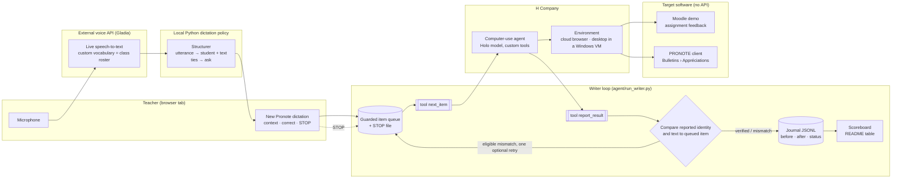

# Calli native writer architecture

Calli's native writer accepts a teacher's completed dictation after identity, course, text and STOP checks, or a manually confirmed correction. Holo writes the queued text in the target application, leaves the field and reads it back. Python compares that reported read-back with the queued text and records the result. Screen content is data, never an instruction to the agent. The [product and API map](calli-api-and-architecture.md) covers preparation, exercises, outings and family views.

## Components



## One item, end to end

```mermaid
sequenceDiagram
    autonumber
    participant P as Teacher
    participant G as Gladia live STT
    participant S as Dictation policy + correction UI
    participant Q as Queue
    participant A as H agent (cloud browser or Windows desktop)
    participant W as Target app (Moodle / PRONOTE)
    participant C as Calli (tools, verifier, journal)

    P->>G: "Barbara, participe bien, doit soigner la rédaction"
    G->>S: final utterance (roster as custom vocabulary)
    S->>S: Check pupil, course, text and STOP
    alt completed unambiguous dictation
        S->>S: Accept once for this turn
    else manual correction needed
        S->>P: Show candidate and correction
        P->>S: Confirm corrected text
    end
    S->>Q: item (student, text, previous_value)
    A->>C: next_item()
    C-->>A: item
    A->>W: find the student, write the text, save
    A->>W: leave the page, come back, read the field
    A->>C: report_result(item_id, student_seen, text_read_back, "written")
    C->>C: Check reported full name and normalized text
    alt missing read-back or uncertain write
        C->>C: journal: unknown, never retry automatically
    else matching identity and text
        C->>C: journal: verified
    else different
        C->>C: journal: mismatch
        opt correct identity and retry enabled
            C->>Q: One new corrective item, using the reported previous value
        end
    end
    C-->>A: recorded; call next_item
```

## States

| Blueprint state (approval screen) | Loop or journal status |
|---|---|
| CREATED, TRANSCRIBED, MATCHED, NEEDS_DISAMBIGUATION, REVIEWED | before the queue |
| APPROVED | `pending` |
| EXECUTING | `in_progress` |
| VERIFYING | inside `report_result` |
| VERIFIED | `verified` |
| FAILED | `mismatch`, `not_found`, `false_success` |
| HALTED | `aborted` (STOP stops future writes; it reverts nothing) |

The state table retains the original manual approval vocabulary. A valid completed dictation uses `source=automatic_dictation` and enters the same `pending` queue without an extra approval click. An undo is a new confirmed item whose text is the previous value; it goes through the same loop. The recorded presentation writer uses `--no-retry`: the corrective retry in the general diagram is disabled for that run.

## Why the status is never the agent's word

Run 2 on 7 November: the agent reported `written` for a comment, and the read-back it returned said "rédactation" for "rédaction". Our comparison recorded `mismatch` and queued one corrective write. Whether the slip was in the typing or in the reading, the teacher sees a red line instead of a wrong report card. See [`runs/`](../runs) and the scoreboard in the README.

## Where things run

| Piece | Runs on | Why |
|---|---|---|
| New Pronote, queue, journal, verifier | local Python service; recorded native demo on the Windows VM | the UI and writer share the queue; API keys stay server-side |
| Agent | H Company cloud (model) + environment: H cloud browser for Moodle, `h/holo-desktop` inside a Windows VM for PRONOTE | PRONOTE's server and single-user build are Windows-only; the VM is a KVM guest inside a Devin cloud machine for the hackathon |
| Speech-to-text | Gladia live API | roster vocabulary helps name recognition; confidence and identity checks still apply |

Rendered native component view: [SVG](architecture.svg), [PNG](architecture.png), [PlantUML source](architecture.puml).
The [integrated architecture](calli-system.md) also covers preparation, exercises, outings and the family view.
