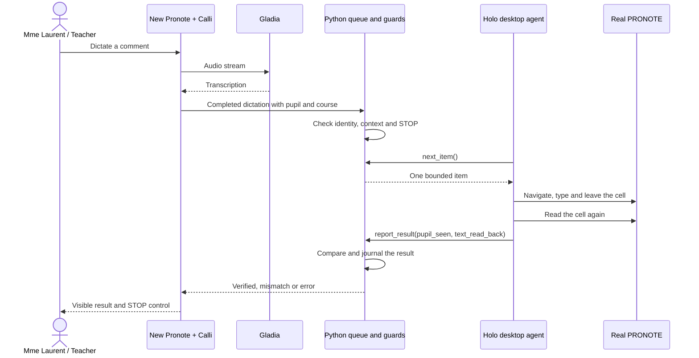
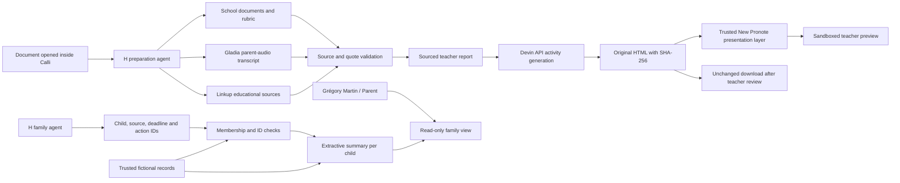

# Calli: product and API map

Public release, 8 November 2026. New Pronote is the workspace; Calli is the assistant. The PRONOTE desktop remains the system operated by the native writer. All demonstration pupils are fictional.

## User roles

| Role | Demo identity | Working flow |
|---|---|---|
| Teacher | Mme Laurent | Open a pupil's work, inspect a sourced preparation, preview a practice activity, dictate a comment and inspect its read-back result. |
| Parent | Grégory Martin, father of Alex Martin and Lucas Martin | Read a summary per child, the next deadline, a useful action and linked source documents. No school-data writes from this view. |
| Student | Alex Martin | Use a generated practice activity and receive step-by-step feedback. The main demo shows the teacher preview, not a separate authenticated student session. |
| Administration | Future production role | Review outing information and unresolved requirements. The outing research uses real tools; bookings are not implemented; Stripe sandbox Checkout is configurable but not yet tested against an account. No production administrative account exists. |

The parent persona is a demonstration view, not an authorization boundary. Production identity and access control remain separate work. The [use-case model](calli-use-cases.md) expands the four roles, including proposed attendance and absence management. The [integrated architecture](calli-system.md) and [developer guide](developer-guide.md) map these flows to modules and tests.

## API inventory and evidence

| Service | Purpose in Calli | What has actually been verified | Limit |
|---|---|---|---|
| H Company Agents API / Holo desktop | Operate real PRONOTE; call queue and reporting tools | A native comment was written and independently read back; queue-to-verified 25.57 s | One recorded item is not a reliability study. |
| H Company managed agents | Select tools and prepare sourced material | Real preparation; real family run with four tool calls and validated IDs in 16.29 s | The displayed saved family demo is labelled separately. |
| Gladia | Speech to text | Real live transcription of a synthetic dictation; pre-recorded parent audio in the preparation run | Synthetic audio does not measure real microphone accuracy. |
| Linkup | Retrieve educational sources | Two real searches in the recorded preparation run | External resources support learning, not a pupil's grade. |
| Cognition / Devin API | Generate an interactive practice activity from the sourced preparation | Real session, retrieved HTML, wrong-answer feedback, progression and reset checked in the integrated UI | About 565 s generation time for the latest learning-science exercise; not instant. No learning-effectiveness study. |
| ElevenLabs | Fictional parent audio and demo narration | Real Alice API responses, file hashes and decoded audio; female French dictation redub | Synthetic audio and redub are identified; the original native proof is preserved. |
| OSRM | Route estimation for outings | Present in François's outing flow | A route estimate is not a coach booking or authorized drop-off location. |
| Google OIDC / Calendar | Optional hosted access and calendar integration | Included in François's code and tests | The current local unified preview does not assert a new production deployment. |
| Stripe | Optional hosted Checkout for an outing contribution, separate from offline previews | Official SDK and signed-webhook contract verified offline; durable idempotent ledger | No configured-account run or real collection yet. [Setup and limits](outing-stripe-checkout.md). |
| Gradium | Available key mentioned by the user | Not used in the verified delivery | Do not list as an implemented integration. |

Devin CLI is also the engineering/cloud-workstation tool. That use is distinct from the product's Cognition API integration. A displayed provider logo or offline simulation is not evidence of an API call.

## Native comment path

Computer use crosses the legacy interface. Function calling gives it a bounded item, checks the reported outcome and persists state. Python owns orchestration and validation; H chooses and executes the computer actions. No PRONOTE API is used by this native writing path.

## Preparation, practice and family

The family agent calls `list_family_children`, `read_child_updates` for each child and `validate_family_digest`. It selects source identifiers; the server renders text directly from the trusted record. Suggested actions come from a reviewed list. A previous trial returned a typo after validating a correct draft and was refused; the ID-only format removes that copy-error surface.

The family summary uses at most two selected source excerpts per child, taking complete leading sentences up to 120 characters, with the source title as a fallback. It includes the next selected deadline relative to the snapshot date and the first selected same-child action. Missing data remains explicit in the expandable source details. Source links only refer to the corresponding child; there is no new generated grade or ungrounded overall assessment.

The pipeline preserves failures. The family trials were 16.926 s (refused) and 16.29 s (accepted on the corrected schema). These are execution times, not human time savings.

The exercise preview response adds New Pronote CSS, embedded local fonts and a constant Escape bridge. It keeps the stored artifact and download unchanged. Both the response and derived meta CSP permit `font-src data:`; other restrictions remain, including `connect-src 'none'` and an `allow-scripts` sandbox without same-origin. The parent only accepts the close message from its own iframe. Headers identify the presentation version and original SHA-256.

## Release and deployment

- Public source: https://github.com/CalliH2026/app.
- The release integrates François’s workspace, Calli’s native writing and research, a family view, role-specific presentation and the optional Stripe Checkout adapter.
- Local launcher: `python -m ui.shell --stop`; install `.[shell,voice]`. The native writer starts separately on the PRONOTE machine.
- Public preview: https://calli-demo.leisurelychestnut.chatgpt.site with a [testing guide](https://calli-demo.leisurelychestnut.chatgpt.site/guide). It uses saved real outputs through allowlisted routes; no native writes or fresh provider calls. The exercise remains interactive.
- Source and deployment template: `sites/calli-demo/`. Its offline checks cover routing, read-only boundaries, content and privacy-preserving aggregate counters.

## Human-time estimate

For ten already-written comments (1,291 characters, 215 words), the documented model uses typing at 225 characters/minute, dictation at 100 words/minute and 8 seconds of review per comment in both paths, plus 4 seconds of manual navigation or 3 seconds of dictation-turn handling per comment. It yields 464.267 s versus 239 s, or 48.521% less active entry time. This is an estimate without a timed human baseline. Error-rate sensitivity is a scenario analysis, not observed correction data.

The current film uses the intervention-adjusted 43% scenario, documented in [annual time scenarios](annual-time-scenarios.md); the 48.521% figure above is the earlier base model.
