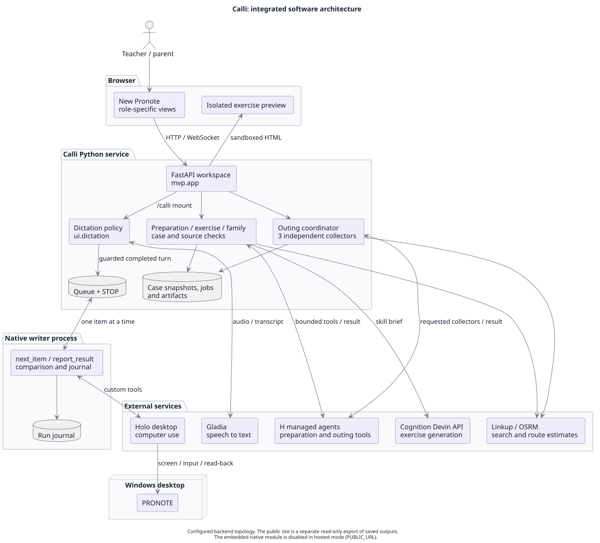
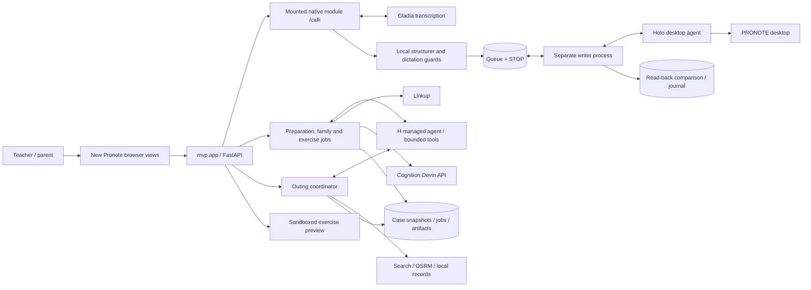
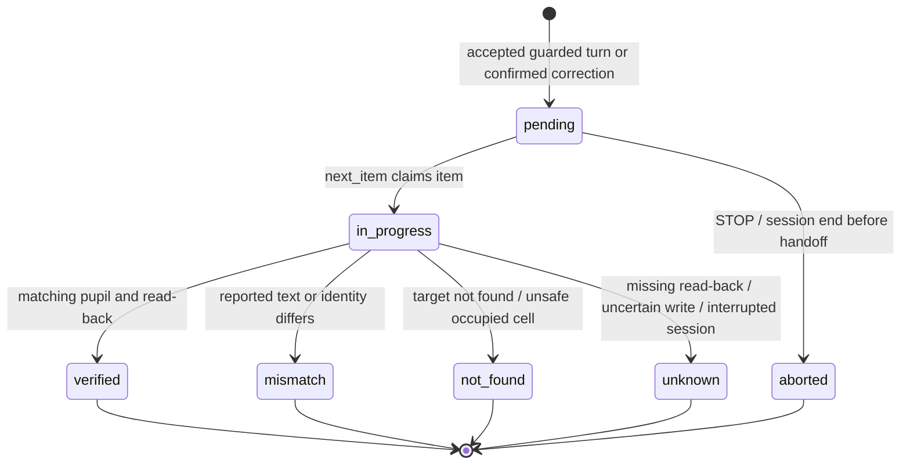

# Calli: integrated architecture

New Pronote is the browser workspace. Calli's Python service owns application state, dispatch, validation and persistence. H chooses computer actions or requests bounded functions; specialised APIs perform transcription, retrieval and exercise generation.



[PlantUML source](calli-system.puml) · [PNG](calli-system.png) · [Native writer details](architecture.md) · [Source and test map](developer-guide.md)

## Components in Mermaid



## Runtime boundaries

| Boundary | Responsibility | Constraint |
|---|---|---|
| Browser → Python | Send an explicit action or a Calli document-open event; render sources and state. | The browser does not supply trusted pupil identity, case contents or provider secrets. Observation is inside Calli, not a universal desktop observer. |
| Dictation → native writer | Append one guarded item to the shared queue. | The writer is a separate process. Launching the UI does not start native writes. |
| Writer → Holo → PRONOTE | Deliver an item, perform screen actions, report the pupil and text read back. | Python checks the reported text and identity. That comparison is not an independent visual audit of the physical row. |
| Preparation → H / Linkup | Select bounded tools and source identifiers; validate the case and references. | The native preparation path in `research/` and the imported workspace pipeline in `mvp/` coexist; they are not a single fully refactored engine. |
| Preparation → Devin | Send the exercise skill brief and retrieve its artifact. | Generation is separate from grading; no silent fallback from a failed live run to a simulation. |
| Outing → collectors | Dispatch up to three independent tools requested by H; aggregate results. | A partial dossier and unavailable requirements remain explicit. Existing preview operations are not bookings or payments. |
| Family → sources | Select validated IDs and render text from trusted records. | The view is read-only; demo persona switching is not production authorisation. |

## Outing tool sequence

```mermaid
sequenceDiagram
    participant H as H agent
    participant T as Function tools
    participant P as OutingExecutionPool
    participant S as Stored dossier
    H->>T: search_museum_visit()
    T->>P: request(visit)
    P-->>H: Execution ticket
    H->>T: prepare_transport_and_calendar()
    T->>P: request(route)
    P-->>H: Execution ticket
    H->>T: read_class_and_template()
    T->>P: request(roster)
    P-->>H: Execution ticket
    par Requested visit collector
        P->>S: Visit sources or explicit failure
    and Requested route collector
        P->>S: Route estimate and local agenda
    and Requested roster collector
        P->>S: Class and administrative template
    end
    H->>T: wait_for_outing_results()
    T->>P: Wait within time budget
    P-->>H: Ready or still pending; execution details
    H->>T: Fill dossier after readiness check
    T->>S: Validated / partial draft
```

Requests are issued separately; their worker executions can overlap. The pool never launches all tools merely because it exists. Repeated requests reuse the existing execution. Closing the pool prevents late results from being published.

## Native item state



This is the live dictation path. An eligible mismatch can create one **new** corrective item if retries are enabled; the presentation uses `--no-retry`. Unknown results never trigger an automatic retry. STOP stops future handoffs and does not roll back an in-flight write.

## Public exploration versus configured backend

The [public site](https://calli-demo.leisurelychestnut.chatgpt.site) serves the accepted views and saved real outputs through an allowlisted Worker. It permits GET/HEAD, with an interactive exercise, and has no provider keys or write endpoint. It is not a public Windows session. Its reproducible source is in [`sites/calli-demo/`](../sites/calli-demo/README.md).

The configured backend above starts with `python -m ui.shell --stop`. Its optional hosted mode has separate Google authentication configuration and disables the `/calli` native mount. Neither hosted mode nor the public export establishes the four production roles proposed in the [use-case model](calli-use-cases.md).

## Render the PlantUML sources

The checked-in SVG and PNG files were rendered locally with PlantUML 1.2026.9 (Java 8 build) and Graphviz 15.1.0. Mermaid diagrams remain text in Markdown and render on GitHub.

```sh
java -jar /path/to/plantuml-java8-1.2026.9.jar -checkonly docs/calli-use-cases.puml docs/calli-system.puml docs/architecture.puml
java -jar /path/to/plantuml-java8-1.2026.9.jar -tsvg -nometadata docs/calli-use-cases.puml docs/calli-system.puml docs/architecture.puml
java -jar /path/to/plantuml-java8-1.2026.9.jar -tpng -nometadata docs/calli-use-cases.puml docs/calli-system.puml docs/architecture.puml
```

The renderer is a documentation tool, not a runtime dependency. The [official release](https://github.com/plantuml/plantuml/releases/tag/v1.2026.9) Java 8 asset has SHA-256 `9de63b51b10517b783253e0964d1db9b574506b70ea2aa8c3fa107ac17db8f06`. No project source was sent to a remote diagram-rendering service.

## Optional outing Checkout extension

The separate [Stripe sandbox adapter](outing-stripe-checkout.md) adds a durable contribution ledger, hosted Checkout and signed webhook verification. It does not promote the original simulated collection into payment evidence. No configured-account execution is claimed; the public Site stays read-only. A payment sequence and configuration contract are documented alongside the adapter.
