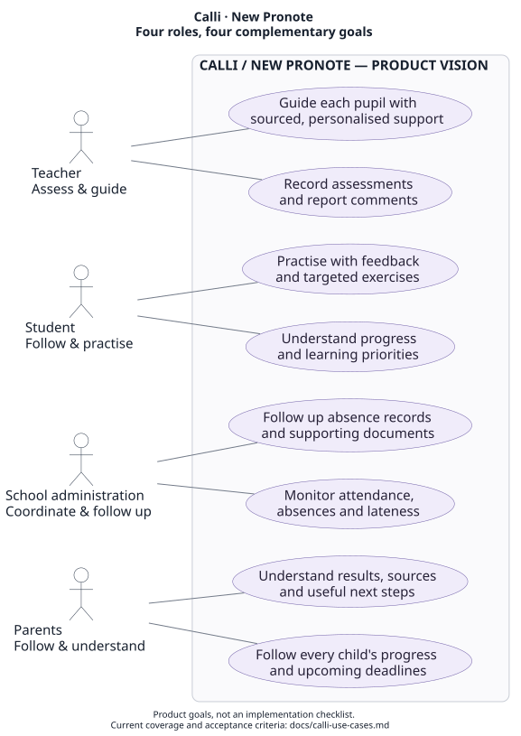

# Calli: users and use cases

Calli helps a teacher **assess and guide**, a student **follow and practise**, school administration **coordinate and follow up**, and parents **follow and understand**. New Pronote presents the relevant information for each role; Calli connects that workspace to the existing software and tools.

[Editable PlantUML](calli-use-cases.puml) · [PNG](calli-use-cases.png) · [Software architecture](calli-system.md) · [Developer guide](developer-guide.md)

The diagram describes the product vision. An actor expresses a user's goal, not an existing login or permission. The following table separates working capabilities from proposed extensions.

## Goals and current coverage

| Actor / goal | Concrete use cases | Current MVP | Next extension |
|---|---|---|---|
| Teacher — assess and comment | Record a teacher-assigned grade, enter a report comment, inspect the saved result, correct an ambiguity. | The workspace accepts a teacher's assessment. The native comment path dictates, writes and reads back a PRONOTE appreciation. | Native grade entry and broader assessment workflows need their own integration and evidence. Calli does not independently assign a demonstrated grade. |
| Teacher — guide | Inspect a pupil's work and its sources; prepare an explanation; request a targeted activity. | H prepares a sourced report; the Devin API can generate an interactive Pythagorean activity. | Extend to more subjects and evaluate pedagogical usefulness with teachers. |
| Student — follow | Understand what was achieved, what remains difficult and what to work on next. | The activity explains individual answers. There is no dedicated longitudinal student dashboard. | A student view with progress over time and teacher-selected priorities. |
| Student — practise | Attempt a targeted exercise, receive feedback, retry and progress. | The exercise is interactive and demonstrated through the teacher preview. | A separate student account, assignments and persistent learning history. |
| Administration — coordinate | Review attendance, lateness, unresolved absences and supporting documents; organise follow-up. | No operational attendance or absence-management workflow is implemented. | An administrative view with source-linked records, explicit status changes and appropriate access. An illness-related absence is an administrative reason; interpreting medical details is outside this proposed workflow. |
| Parents — follow | Read a concise overview for each child; find deadlines and useful actions. | Mme Martin's read-only view covers Alex Martin and Lucas Martin, with an extractive summary per child. | Live authorised synchronisation and configurable notifications. |
| Parents — understand | Trace a statement to its school source; understand feedback and the next useful step. | Each selected point links to the corresponding child's source; actions come from the known records. | Clearer explanations tested with parents, without replacing the teacher's assessment. |

**Shared school-trip use case:** teachers prepare a sourced outing dossier; an administrative reviewer would examine missing requirements, logistics and budget. The current flow has real H-requested collection tools and a partial draft. A dedicated administrative role, booking, payment and message sending are not part of that verified execution.

## Interaction principles

- Show one coherent interface with a view appropriate to the role. A parent should not navigate the teacher's grading tools to understand two children's week.
- Give each actor a result, its source and a useful next step. Keep API traces available in details for technical review.
- Keep the teacher's assessment separate from an agent's explanation or proposed exercise.
- Use computer use where the existing application must be operated; use functions for transcription, retrieval, calculation, validation and storage.
- Treat persona switching in the demo as presentation. It does not establish production identity, family membership or school permissions.

## Acceptance criteria for the next iterations

| Scenario | Observable criterion | Status |
|---|---|---|
| Teacher dictates a comment | One completed, unambiguous turn queues at most one item; the journal records the read-back comparison. STOP prevents future writes and does not claim rollback. | Implemented; tests in `tests/test_dictation.py`, `tests/test_queue_store.py`, `tests/test_writer_identity.py` and `tests/test_writer_unknown.py`. |
| Teacher requests support | A report refers to the selected case; unknown evidence IDs or mismatched snapshots cannot become trusted sources. | Implemented; `tests/test_dossier.py`, `tests/test_observation.py`, `mvp/test_native_pipeline.py`. |
| Student practises | A wrong answer gets feedback, progression follows correct answers, and reset starts a fresh exercise state. | Interactive artifact checked in the teacher preview; no separate student login. |
| Parent opens the family view | Both children appear; every summary/source/deadline/action remains attached to the correct child. | Implemented; `mvp/test_family.py`. |
| Administration follows an absence | A record identifies pupil, date, attendance status, supporting-document state and source; access is limited to the authorised role. | Proposed acceptance criterion, not a shipped feature. |

For run evidence, provider limits and the public preview's scope, see the [product and API map](calli-api-and-architecture.md). For a source-to-test map, see the [developer guide](developer-guide.md).
