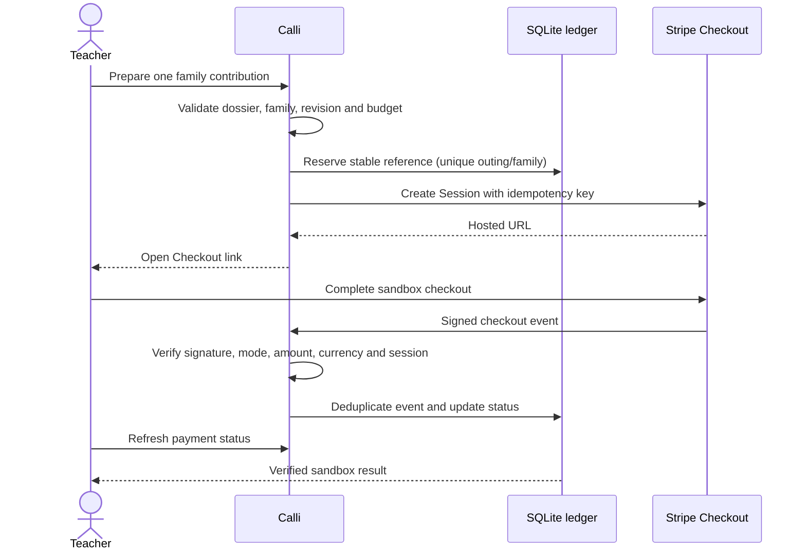

# School outing contributions with Stripe Checkout

Calli now has an optional **Stripe-hosted Checkout** integration alongside the original offline collection preview. The integration calls Stripe's API when configured; it has been verified offline with the official Python SDK and signed webhook fixtures. No real Stripe session or funds transfer was executed during this delivery because no test key was supplied.

## Scope and setup

The shared hackathon dataset is fictional. This implementation accepts **sandbox/test keys only**, including restricted test keys, and rejects live credentials. Stripe test environments do not move real money. Production collections require a separate access-control, account activation and reconciliation rollout; changing a flag is not a production migration.

Install the product with `pip install -e '.[shell]'` (includes `stripe==16.1.0`), or install `mvp/requirements.txt`. Set these environment variables in the server environment, never in browser code:

| Variable | Value |
|---|---|
| `CALLI_STRIPE_ENABLED` | `true` to opt in; absent means disabled |
| `STRIPE_SECRET_KEY` | A sandbox secret or restricted key from Stripe; never commit it |
| `STRIPE_WEBHOOK_SECRET` | Signing secret for this exact webhook endpoint |
| `STRIPE_RETURN_BASE_URL` | Fixed origin such as `http://localhost:8000`; HTTPS for a hosted server |
| `PRONOTE_DATA_DIR` | Persistent per-account directory for the job data and SQLite payment ledger |

Open **Sorties scolaires → Collecte → Stripe Checkout · connexion**. Each available family contribution can create a hosted Checkout session. The price comes from the completed server-side budget. A visible link opens Stripe in a new tab. A refresh reads the ledger after the webhook. The original simulated collection stays independent and never becomes proof of payment.

The public ChatGPT Site remains a read-only export. It cannot create Checkout sessions. The hosted Sites proxy is explicitly rejected by payment creation/status routes.

## Local Stripe test

1. Start the configured local application with its existing shell launcher.
2. Run `stripe listen --events checkout.session.completed,checkout.session.async_payment_succeeded,checkout.session.async_payment_failed,checkout.session.expired --forward-to localhost:8000/api/stripe/webhook`.
3. Store the **signing secret printed by this listener** as `STRIPE_WEBHOOK_SECRET`, then restart the application. It differs from a Dashboard endpoint's secret.
4. Prepare a completed outing and its family list. Create one contribution using the panel, then complete Checkout with a documented Stripe test payment method. Do not use real card information in test mode.
5. Refresh the panel. Only the signed webhook can show `Réglé · test confirmé`. Refreshing or forging `/payments/return?status=paid` does not change the ledger.
6. Verify duplicate and cancellation behavior in the Stripe sandbox. Record a real sandbox result before claiming end-to-end payment verification.

For a hosted deployment, register the exact HTTPS `/api/stripe/webhook` URL. This **single POST** is exempt from browser session/origin checks because Stripe signs it; the host check, payload limit and signature verification remain. The rest of the application still requires the existing hosted authentication policy.

## Contract and state

- `GET /api/stripe/config`: capability and configuration message, never secrets.
- `GET /api/outings/{id}/checkout`: family labels and local Stripe ledger statuses.
- `POST /api/outings/{id}/checkout`: body `{ "family_id": "family-01" }`; extra fields, prices and redirect URLs are rejected.
- `POST /api/stripe/webhook`: original raw bytes, `Stripe-Signature`, SDK timestamp/signature verification.
- `GET /payments/return`: informational page only; query strings are ignored.

The ledger stores opaque references, amount, status and session URL; no card data, names or email addresses are sent in metadata. A timeout preserves the idempotency key. Retries stop at 23 hours to avoid recreating an uncertain charge after Stripe's idempotency window. Expired sessions and changed budgets require manual reconciliation instead of creating an automatic replacement. Paid states cannot regress on late events. The ledger must be persisted and backed up; losing it requires reconciliation before further checkouts. It is for one Stripe sandbox account and one shared demonstration workspace, not multi-tenant school billing. Refunds, disputes, automated reminders and live settlement are not implemented.

## Verification

`pytest -q mvp/test_outing_checkout.py mvp/test_outing_checkout_routes.py mvp/test_calli_outing_payments.py`

Covers server pricing, invalid budgets, stale/unknown/declined families, durable idempotency, timeout retry, real SDK object handling, signed/tampered webhook bytes, mismatched amount/currency/session/mode, duplicate/out-of-order events, hosted auth/origin/proxy boundaries and informational redirects. All tests are offline and require no account key.

Primary references: [Checkout Session creation](https://docs.stripe.com/api/checkout/sessions/create?lang=python), [webhook signatures and local testing](https://docs.stripe.com/webhooks?lang=python), [official Python SDK](https://github.com/stripe/stripe-python), [Stripe testing](https://docs.stripe.com/testing).
